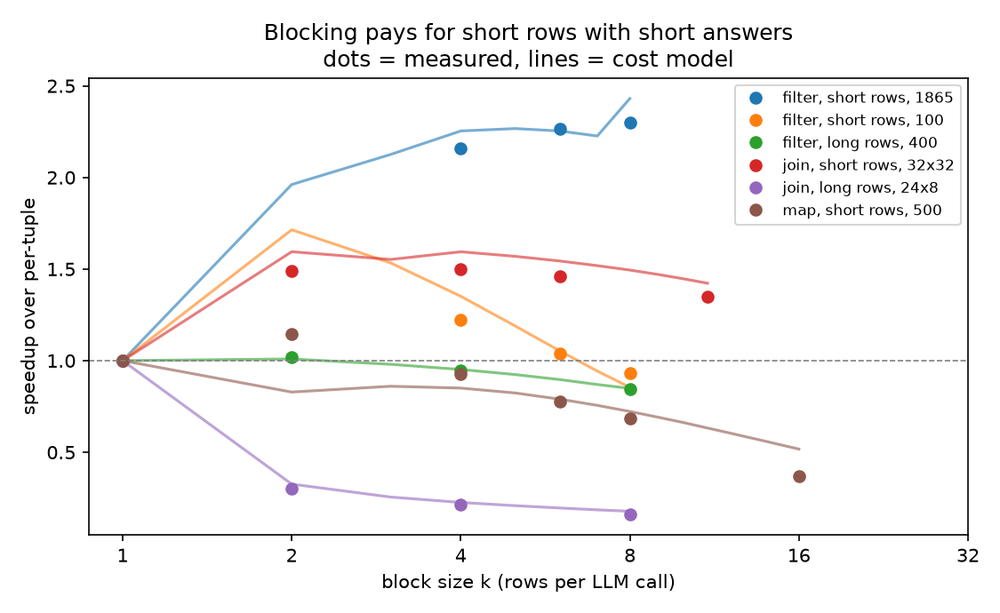
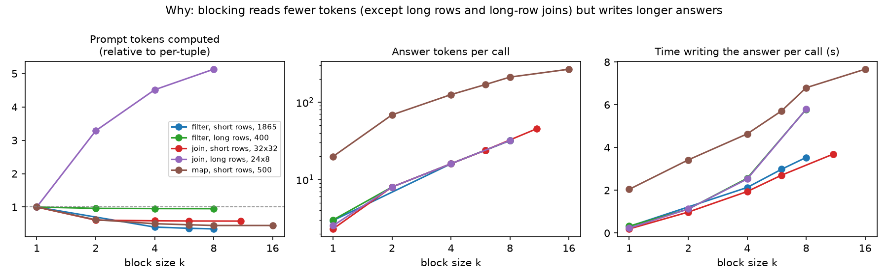
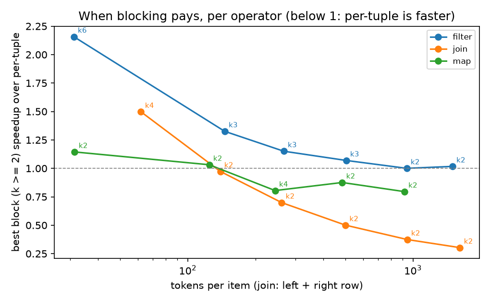
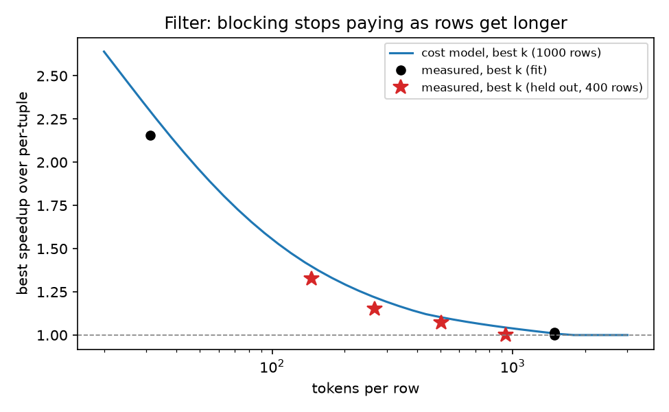
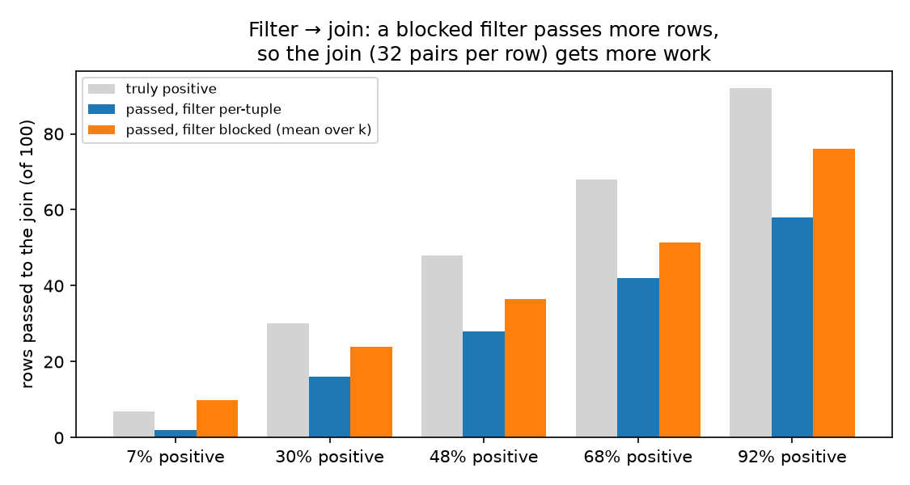
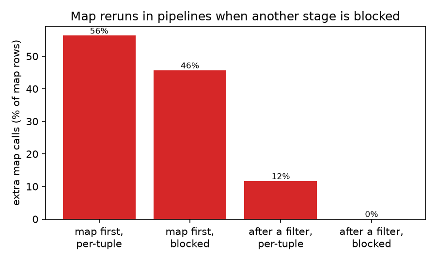
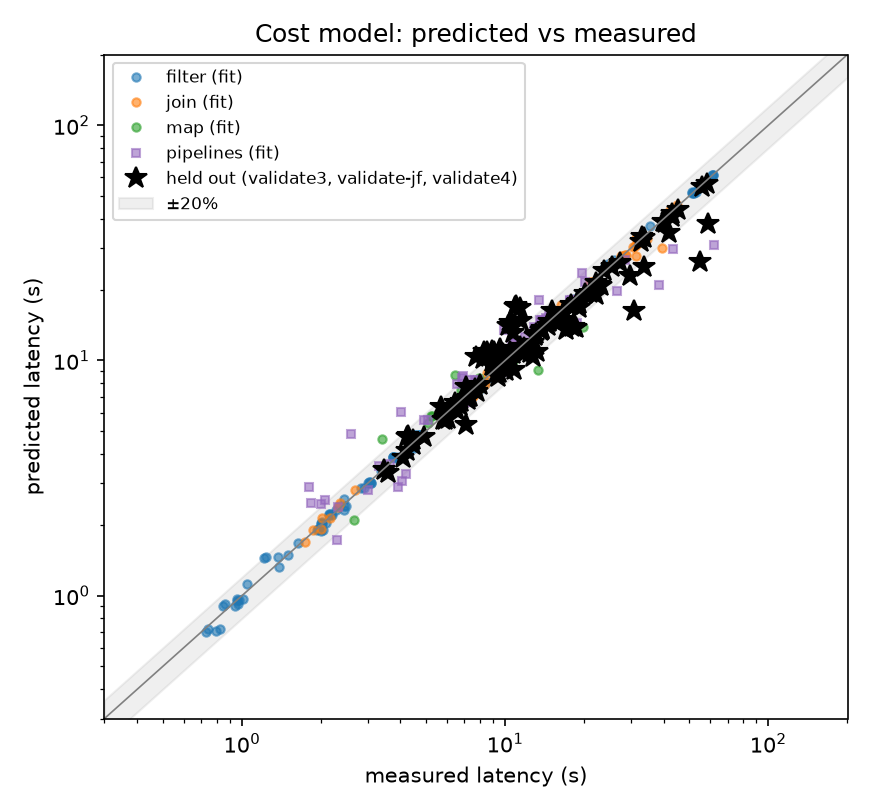
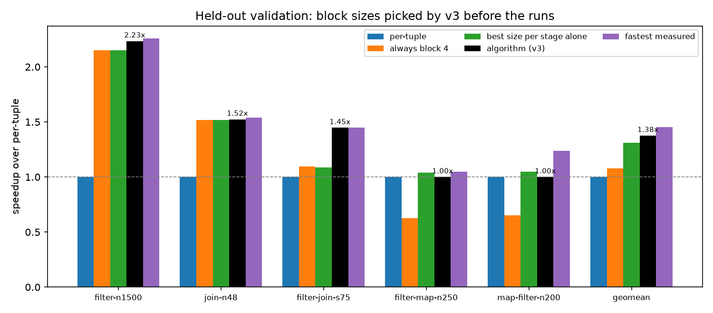
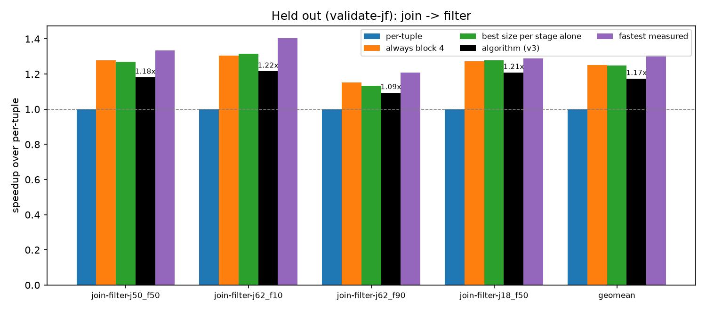
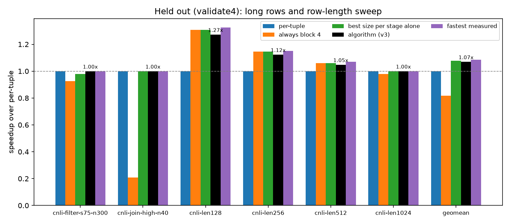

# Choosing block sizes for semantic operators: batching study and cost model v3

Kalypso can answer a semantic operator (filter, join or map) one row per LLM
call (per-tuple), or put k rows in one prompt and answer them together (a block
of size k). This study measures when blocking pays, builds a cost model that
predicts latency for any block size, and uses it to pick a block size for every
stage of a pipeline. The model was then tested on 23 experiments it had never
seen, in three held-out rounds.

**Result:** over all 23 held-out experiments the algorithm ran 1.12x faster
than per-tuple, 3.9% slower than the fastest arm measured (1.16x). It beat
per-tuple, every fixed block size (4: 0.85x, 16: 0.71x, 32: 0.52x) and picking
each stage's best size from the single-operator runs (1.03x).

| Round | Experiments | Algorithm | Best fixed size | Oracle | Algorithm's regret |
|---|---|---|---|---|---|
| `validate3` | short-row filter and join, filter → join, filter → map, map → filter | 1.38x | 1.08x (k 4) | 1.45x | 6.1% |
| `validate-jf` | join → filter, 4 selectivities | 1.17x | 1.25x (k 4) | 1.31x | 11.4% |
| `validate4` | held-out long rows; filter, join and map at ~125–940 tokens per row | 1.03x | 0.69x (k 4) | 1.04x | 1.0% |

The choice is latency first. Accuracy is measured and reported, but it doesn't
drive the choice. An accuracy-guarded variant is reported alongside.

## Setup

| | |
|---|---|
| GPU | NVIDIA L40S (48 GB), one per experiment, on Modal |
| Server | vLLM OpenAI server, prefix caching on, `max_num_seqs` 256, `max_num_batched_tokens` 2048, `max_model_len` 32768 |
| Model | Qwen2.5-7B-Instruct |
| Measurement | 1 warmup, 3 repeats, median; prefix cache reset before every trial; arms interleaved (A, B, A, B) so drift hits all arms alike |
| Arms | `kalypso_per_tuple`, `kalypso_block:k` (same k for every stage), `kalypso_pipe:k1,k2` (a size per stage) |

| Workload | Operator | Rows | Row size (tokens) |
|---|---|---|---|
| `movie_positive`, `movie_sel10…90` | filter (SemBench movie reviews; selectivity 10–90%) | 100–1865 | ~31 (short) |
| `movie_opposite`, `movie_fanout10…90` | join (pairs of reviews) | 16×16 – 64×64 pairs | ~31 per side (short) |
| `movie_map` | map (rewrite a review) | 100–500 | ~31 (short) |
| `cnli_sel10…90` | filter (ContractNLI contracts) | 400 | ~1500 (long) |
| `cnli_join_high/low` | join (contract × clause) | 24 × 8 | ~1600 left, ~15 right (long) |
| `pipe_filter_join_*`, `pipe_filter_map`, `pipe_map_filter` | 2-stage pipelines | 50–1000 | short |

Rows over 512 tokens count as **long**. The model keeps separate numbers for
short and long rows.

## What we learned from the experiments

| Finding | Evidence |
|---|---|
| Blocking pays most for short-row filters with many rows | 1500-row filter: 2.2x at block 6–7 |
| Short-row joins gain about 1.5x, but lose accuracy | join, 48×48 pairs: 1.52x at block 2–4, ΔF1 −0.07 to −0.18 |
| Long rows: blocking can't help | Reading the rows (prefill) dominates. Blocking only saves the per-call instructions and answer, so the ceiling is about (row + 96) / (row + 96/k) ≈ 1.05x for 1.6k-token rows |
| Maps: blocking hurts | A block map writes all k answers in one call, one after another, so that call takes much longer. Map alone: 0.5–0.9x at block 4, 0.37x at block 16. Block 2 on 500 rows was 1.14x, but its outputs didn't match per-tuple's (similarity below 0.8) |
| Block joins repeat the left row in every pair | About 3.3x the prompt tokens for long left rows. Per-tuple gets the left row from the prefix cache |
| The best size differs by operator, row length and N | Short filter: 6–8. Join: 2–4. Long rows and maps: 1 (no blocking) |
| In a pipeline, the best size for a stage isn't its best size alone | Filter → join: the filter runs fastest blocked when measured alone, but the pipeline was fastest with the filter **not** blocked and the join at block 2. Picking each stage's best-alone size gave 0.95x on `validate` |
| Blocking one stage can make a per-tuple map retry | Kalypso's `MapRatioEstimator` learns answer length from the earliest (shortest) answers. When the map's rows arrive in waves, later rows get 11–20 max tokens, get cut off, and rerun at 512 (up to 56% of map rows) |

## The two research questions

### Q1. When does putting several rows in one LLM call beat sending them as separate requests through vLLM?

vLLM already runs separate requests together and reuses shared prompt
prefixes from its cache. So blocking doesn't save work by batching. It saves
the work each call repeats (instructions, answer format, number of call
waves), and in exchange one call writes k answers back to back.

| Case | Blocking pays? | Why | Measured |
|---|---|---|---|
| Short rows, short answers (filter, join), many rows | Yes, k 2–8 | The repeated per-call work is most of each call | filter 2.2x, join 1.5x |
| Few rows (50–100) | Barely | The fixed cost of starting the operator dominates | ≈ 1.0–1.1x |
| Medium rows (~150–500 tokens) | A little, k 2–3 | The repeated per-call work shrinks relative to the row | 1.33x at 146, 1.07x at 505 tokens |
| Long rows (~1000–1500 tokens) | No | Reading the row dominates, and blocking doesn't shrink it | ≤ 1.02x |
| Long answers (map) | No | One call writes all k answers in a row, and its wave waits for the longest | 0.4–0.9x; ≤ 1.03x at any length |
| Joins beyond short rows | No | A block join repeats the long left row in every pair; per-tuple pairs read it once from the prefix cache | 0.97x at ~140 tokens, 0.37x at ~940 |

**Where blocking stops paying, by row length, for every operator.** The
`validate4` sweep runs each operator on ContractNLI contracts cut to a set
length: a filter (400 rows, half entailed, the window keeps each entailed
row's evidence), a join (40 windows × 8 hypotheses) and a map (400 windows,
"what is this part of the contract about?"). The shortest point of each line
is the movie-review workload. Speedup is the best block (k ≥ 2) against
per-tuple; below 1 means per-tuple was faster.

| Tokens per item | Filter | Join | Map |
|---|---|---|---|
| ~31 (movie reviews; join ~62 per pair) | **2.16x** (k 6) | **1.50x** (k 4) | 1.14x (k 2) |
| ~125–145 | **1.33x** (k 3) | 0.97x (k 2) | 1.03x (k 2) |
| ~245–265 | 1.15x (k 3) | 0.70x (k 2) | 0.80x (k 4) |
| ~485–505 | 1.07x (k 3) | 0.50x (k 2) | 0.88x (k 2) |
| ~915–940 | 1.00x (k 2) | 0.37x (k 2) | 0.80x (k 2) |
| ~1500–1600 | 1.02x (k 2) | 0.30x (k 2) | – |

| Accuracy at the best block | Filter (F1 change) | Join (F1 change) | Map (ROUGE-1 vs per-tuple) |
|---|---|---|---|
| ~31 | +0.11 | −0.07 to −0.18 | below 0.8 |
| ~125–145 | −0.12 | +0.14 | 0.44 |
| ~245–265 | −0.11 | +0.01 | 0.43–0.48 |
| ~485–505 | −0.18 | −0.02 | 0.50 |
| ~915–940 | −0.25 | −0.09 | 0.55 |

- **Filter:** pays up to ~500 tokens per row (k 3), shrinking steadily; gone by
  ~1000.
- **Join:** pays only when both sides are short. With a long left row, a block
  repeats it in every pair, while per-tuple pairs share it through the prefix
  cache, so blocking is slower from ~140 tokens on and gets worse with length.
- **Map:** never pays by more than a few percent, and block outputs differ a lot
  from per-tuple (ROUGE-1 0.4–0.55).
- v3 predicted all of these before running and picked per-tuple for every join
  and map length; it was at most 3.2% from the fastest arm.

Filter only, against the cost model's curve:

### Q2. How should blocks be managed through pipelines whose filters shrink and joins expand the rows?

**Blocks stay full.** Between stages, Kalypso's pipeline executor holds incoming
rows until it has k of them. Only the last block of each stage can be short.
In every pipeline run where it can be checked, the calls match full blocks
exactly:

| Pipeline | Arm (stage sizes) | Rows into the blocked stage | Full-block calls | Actual calls | Fill |
|---|---|---|---|---|---|
| filter → join, 10% pass | 1, 4 | 64 pairs | 16 | 16 | 100% |
| filter → join, 50% | 1, 4 | 896 pairs | 224 | 224 | 100% |
| filter → join, 90% | 4, 4 | 2496 pairs | 624 | 624 | 100% |
| filter → join, 75% | 1, 3 | 1344 pairs | 448 | 448 | 100% |
| filter → join, 25% | 2, 8 | 736 pairs | 92 | 92 | 100% |
| map → filter, 500 rows | 1, 7 | 500 rows | 72 | 72 | 100% |
| map → filter, 200 rows | 1, 4 | 200 rows | 50 | 50 | 100% |
| filter → map, 292 passed | 6, 4 | 292 rows | 73 | 73 | 100% |
| filter → map, 589 passed | 3, 2 | 589 rows | 295 | 295 | 100% |

The only extra calls are retries, not partial blocks:

- fallbacks for a row a block answer missed (at most 1 per run)
- block-map repairs
- map reruns: a per-tuple map in front of a blocked filter reran up to 282 of 500 rows

Rows into the next stage are worked out from the per-stage call counts (by
`max_tokens` bucket). Each figure is from one run at temperature 0.

**What changes the next stage's work is how many rows the filter passes, and
that depends on the filter's block size.** A per-tuple filter misses many true
matches. A blocked filter passes more, so the join after it gets more pairs:

| Pipeline (workload) | Truly positive (of 100) | Passed, filter per-tuple | Passed, filter blocked | Join work |
|---|---|---|---|---|
| filter → join (`s10`) | 7 | 2 | 8 (k=4) | 4x |
| filter → join (`s25`) | 30 | 16 | 23 (k=2) | 1.4x |
| filter → join (`s50`) | 48 | 28 | 36 (k=4) | 1.3x |
| filter → join (`s75`) | 68 | 42 | 50 (k=2) | 1.2x |
| filter → join (`s90`) | 92 | 58 | 78 (k=4) | 1.3x |

How to manage blocks through a pipeline:

| Rule | Why |
|---|---|
| Choose block sizes for all stages together, not each on its own | A filter's k changes how many rows the next stage gets. The cost model scores the whole pipeline (1.38x vs 1.31x for each stage's best size alone) |
| Block the expensive stage, not the cheap one in front of it | Filter per-tuple + join at block 2 was fastest (1.45x). Blocking the filter passes more rows to the join. That's more correct, but slower |
| Keep holding rows until a block is full (Kalypso already does) | Fill is 100%, so shrinking doesn't leave half-empty blocks |
| Joins: group the pairs in a block by left row | Today pairs are packed in arrival order, so the left row repeats in every pair (~3.3x the tokens on long left rows) |
| Maps: fix the output-length estimate before blocking around them | Blocking a neighbouring stage makes a per-tuple map cut off answers and rerun them (12–56% of rows) |

**Join first, then a filter** (`validate-jf`: 32×32 review pairs; the join
keeps same-sentiment pairs, then the filter keeps pairs where both are
positive):

| Join keeps / filter keeps | Per-tuple | Static 4 | v3's pick (join, filter) | Fastest measured |
|---|---|---|---|---|
| 50% / 50% | 1.00x | 1.28x | 1.18x (10, 2) | 1.33x (2, 2) |
| 62% / 10% | 1.00x | 1.30x | 1.22x (10, 2) | 1.40x (2, 3) |
| 62% / 90% | 1.00x | 1.15x | 1.09x (10, 2) | 1.21x (2, 2) |
| 18% / 50% | 1.00x | 1.27x | 1.21x (9, 2) | 1.29x (2, 2) |

- Small blocks in both stages won (join 2, filter 2–3). v3 picked join ≈10.
- **The per-tuple join failed on this question.** It kept 0–8% of the true
  same-sentiment pairs; block joins kept 23–49%. v3 expected per-tuple join
  recall of 0.69 (learned on the opposite-sentiment join), so it planned with
  the wrong number of pairs reaching the filter and over-predicted per-tuple
  (16–17 s predicted, ~11 s measured). Latency comparisons hold; the F1
  comparison mostly reflects the per-tuple join failing.
- Lesson: a join's recall depends on how its question is worded, and it can
  differ sharply between per-tuple and block prompts. The model takes recall
  from past runs of the same kind of join.

**Open:**

- **Holding rows vs sending early.** We haven't tested whether holding rows to
  fill a block slows the pipeline. That needs an option to send a partial
  block after a short wait.

## Why the model needs fitting

No fixed rule picks the block size well, as the validation shows: block 4
gives 0.91x–1.08x, block 16 gives 0.55x–0.69x and block 32 0.34x–0.47x. The
right size depends on quantities that can only be measured:

| Depends on | Why it can't be derived on paper |
|---|---|
| Prefill speed, decode-step time, attention cost | Set by the GPU, the model, vLLM's scheduler and its batch limits. They change if any of these change |
| How many tokens a block prompt and a block answer take | Depends on the prompt template and on how much the LLM actually writes per row (a block filter writes ~4.5 tokens per row, a map ~15) |
| Fixed cost of starting an operator | Kalypso overhead. It matters for small inputs |
| Filter recall and false-positive rate at each k | Decides how many rows reach the next stage. Blocked filters keep more rows on short rows (recall 0.79 vs 0.63) and fewer on long rows (0.45 vs 0.70) |
| How stages overlap in a pipeline | They share one GPU, so their costs add up. That has to be checked against measured runs |
| How often a map retries | A side effect of Kalypso's output-length estimator. It can only be counted |

So the model has a fixed shape, below, and its constants are fitted by least
squares on measured runs. Moving to new hardware or a new model means
refitting, not rewriting.

## What the model was fitted on

| Phase | Experiments | What it covers |
|---|---|---|
| `block-size` | 15 runs | Short-row filter (`movie_positive` n500, `movie_sel*`) and join (`movie_opposite`) at k = 2–20 |
| `single` | 12 runs | Filter at n = 100, 250, 1000, 1865; joins at fanout 10–90%, 16–64 rows per side |
| `map` | 2 runs | Map at n = 100, 500 |
| `longrows` | 5 runs | ContractNLI filters (selectivity 10/50/90%) and joins |
| `pipeline` | 5 runs | Filter → join at selectivity 10/50/90%, filter → map, filter → block map; each stage also run alone |
| `validate` | 6 runs | Chosen by the previous model (v2); folded into v3's fit once measured |
| **Total** | **45 runs** | **173 single-operator arms, 75 pipeline arms** |
| `validate3` | 5 runs | **Held out:** chosen by v3 before running, not used in any fit |

## What the cost model computes

### Latency of one operator

`L = g[kind] + α·P + (β + tail[kind])·W·D + γ·C·D + δ·C·p²`

| Term | Meaning | Fitted value |
|---|---|---|
| `g[kind]` | Fixed cost per operator | filter −0.057 s, join −0.048 s, map 0.286 s |
| `α·P` | Prefill: P = prompt tokens actually computed (not served from the prefix cache) | 0.792 s per 10k tokens (12.6k tokens/s) |
| `β·W·D` | Decode: W waves of calls (256 calls per wave), each lasting D decode steps | 24.8 ms per step |
| `tail[map]·W·D` | Maps only: a wave lasts as long as its longest answer, not its average | +11.0 ms per step |
| `γ·C·D` | Extra cost per generated token from a bigger running batch | 0.100 ms per token |
| `δ·C·p²` | Attention, quadratic in prompt length (shows up on long rows) | 1.77 ms per call per (1k tokens)² |

### Tokens for a block size

| | Per-tuple (k = 1) | Block (k > 1) |
|---|---|---|
| Calls C | N | ⌈N / k⌉ |
| Decode steps per call D | fitted per kind | d0 + d1·k (answer grows with k) |
| Prompt per call p | row + instructions | instructions + k·(row + separator) |
| Computed prompt P | N·(row + instructions); joins compute each left row once (prefix cache) | rows + per-call overhead; joins pay the left row on almost every call |
| Block-size limit | – | Whatever fits in the context window, and no larger than the largest size measured for that operator and row length |

Per-kind token constants (fitted):

| Kind | Instruction tokens (per-tuple) | Answer tokens (per-tuple) | Block instructions | Answer: base + per row |
|---|---|---|---|---|
| filter | 133 | 3.0 | 52 | −2.6 + 4.5·k |
| join | 157 | 2.3 | 90 | −2.6 + 4.6·k |
| map | 128 | 20.1 | 72 | 63 + 14.7·k |

### Pipelines

| Feature | Rule | Fitted value |
|---|---|---|
| Stages share one GPU | L = λ · Σ stage latencies | λ = 0.98 |
| Rows a filter passes on | rows · (recall(k)·s + fpr(k)·(1 − s)), s = the workload's true selectivity | recall/fpr per k, short vs long rows (below) |
| Map retries | Extra map calls when another stage is blocked. They redo the work but don't pay the fixed cost again | map first, per-tuple 56%; map first, blocked 46%; map after a filter, per-tuple 12%; after a filter, blocked 0% |

Filter recall and false-positive rate by block size (fitted on the single-filter runs):

| Rows | k = 1 | Blocked (k ≥ 2) |
|---|---|---|
| Short | recall 0.63, fpr 0.013 | recall ~0.79, fpr ~0.03 |
| Long | recall 0.70, fpr 0.35 | recall ~0.45, fpr ~0.2 |

### The choice

| Step | Rule |
|---|---|
| Candidates | Every combination of k per stage, from 1 up to the stage's block-size limit |
| Pick | Lowest predicted pipeline latency |
| Tie-break | Among predictions within 2% of the best (about the model's error), the smallest blocks |
| Guarded variant (reported) | Also caps each k at the largest measured size whose mean F1 stayed within 0.02 of per-tuple (maps: ROUGE-1 ≥ 0.8) |

### How accurate the model is

| Prediction error | Mean | Max |
|---|---|---|
| Single operator, given measured tokens | 3.4% | 33% |
| Single operator, full model | 4.3% | 36% |
| Single operator, leave one workload out | 4.8% | 61% |
| Pipelines, given measured filter output and retries | 10.9% | 58% |
| Pipelines, full model | 13.2% | 87% |
| Held-out `validate3`, the arm the algorithm picked | 8.9% | 25% |
| All 23 held-out experiments, the arm the algorithm picked | 6.5% | 25% |

## Validation

Each validation experiment ran per-tuple, static block sizes 4, 16 and 32,
"best in isolation" (each stage at the size that was fastest when that operator
ran alone), the algorithm's pick, the guarded pick and a grid of nearby sizes.
**Oracle** = the fastest arm measured. **Regret** = how much slower than the
oracle. **Speedup** is the geometric mean against per-tuple.

### Held out: `validate3` (picked by v3 before running)

| Strategy | Speedup | Regret (mean) | Regret (max) | Kept accuracy |
|---|---|---|---|---|
| Per-tuple | 1.00x | 50.6% | 126.0% | 5/5 |
| Static block 4 | 1.08x | 39.0% | 89.4% | 2/5 |
| Static block 16 | 0.69x | 162.8% | 437.7% | 1/5 |
| Static block 32 | 0.47x | 346.4% | 857.7% | 1/5 |
| Best in isolation | 1.31x | 11.6% | 32.9% | 3/5 |
| **Algorithm (v3)** | **1.38x** | **6.1%** | 23.8% | 3/5 |
| Algorithm, accuracy-guarded | 1.17x | 25.6% | 53.8% | 5/5 |
| Oracle | 1.45x | 0% | 0% | 3/5 |

| Experiment | Algorithm picked | Speedup | Oracle | Regret | ΔF1 | Predicted / measured (s) |
|---|---|---|---|---|---|---|
| Filter, 1500 short rows | block 6 | 2.23x | block 7, 2.26x | 1.1% | +0.11 | 6.12 / 6.55 |
| Join, 48×48 pairs | block 2 | 1.52x | block 3, 1.54x | 0.9% | −0.18 | 15.91 / 16.73 |
| Filter → join, 75% selectivity | filter 1, join 2 | 1.45x | same | 0% | −0.13 | 10.88 / 10.40 |
| Filter → map, 250 rows | per-tuple | 1.00x | filter 2, map 1, 1.05x | 4.7% | 0.00 | 4.61 / 4.45 |
| Map → filter, 200 rows | per-tuple | 1.00x | map 1, filter 2, 1.24x | 23.8% | 0.00 | 5.31 / 7.08 |

The one real miss is map → filter. The model predicted 5.3 s for per-tuple, but
it took 7.1 s, with no map retries in that run. The blocked-filter arms also
varied by about 1 s between repeats (5.7–6.7 s), so part of the gap is noise.

### Held out: `validate-jf` (join → filter, picked by v3 before running)

| Strategy | Speedup | Regret (mean) | Regret (max) | Kept accuracy |
|---|---|---|---|---|
| Per-tuple | 1.00x | 30.9% | 40.5% | 4/4 |
| Static block 4 | 1.25x | 4.6% | 7.7% | 4/4 |
| Static block 16 | 0.89x | 46.3% | 50.7% | 4/4 |
| Static block 32 | 0.62x | 110.2% | 119.7% | 2/4 |
| Best in isolation | 1.25x | 4.8% | 6.8% | 4/4 |
| **Algorithm (v3)** | **1.17x** | **11.4%** | 15.5% | 4/4 |
| Algorithm, accuracy-guarded | 1.07x | 22.7% | 31.9% | 2/4 |
| Oracle | 1.31x | 0% | 0% | 4/4 |

v3 lost to static 4 here: it picked join ≈10 where join 2 was fastest, misled by
the per-tuple join's recall (see Q2). "Kept accuracy" is against a per-tuple run
whose join barely matched, so it is not a meaningful bar in this round.

### Held out: `validate4` (long rows and row lengths, picked by v3 before running)

| Strategy | Speedup | Regret (mean) | Regret (max) | Kept accuracy | Ran |
|---|---|---|---|---|---|
| Per-tuple | 1.00x | 4.1% | 32.6% | 14/14 | 14 |
| Static block 4 | 0.69x | 73.6% | 379.7% | 4/14 | 14 |
| Static block 16 | 0.65x | 78.0% | 264.0% | 3/14 | 8 |
| Static block 32 | 0.51x | 131.1% | 352.1% | 3/14 | 7 |
| Best in isolation | 0.90x | 22.1% | 181.8% | 8/14 | 14 |
| **Algorithm (v3)** | **1.03x** | **1.0%** | 4.2% | 10/14 | 14 |
| Algorithm, accuracy-guarded | 1.03x | 0.8% | 4.2% | 11/14 | 14 |
| Oracle | 1.04x | 0% | 0% | 9/14 | 14 |

Static 16 and 32 ran on 8 and 7 of the 14 experiments. On long rows some
didn't fit the context window. The join and map length runs stopped at k 8,
because a k = 32 block map on long rows ran past the client's one-hour timeout.

| Experiment | v3 picked | Speedup | Fastest measured | Regret | Predicted / measured (s) |
|---|---|---|---|---|---|
| Long-row filter (75%, 300 rows) | per-tuple | 1.00x | per-tuple | 0% | 38.8 / 39.7 |
| Long-row join (40 × 8) | per-tuple | 1.00x | per-tuple (k 4: 0.21x) | 0% | 10.0 / 9.4 |
| Filter, ~146 tokens | k 2 | 1.27x | k 3, 1.33x | 4.2% | 5.63 / 6.05 |
| Filter, ~267 tokens | k 2 | 1.12x | k 3, 1.15x | 2.4% | 9.54 / 10.14 |
| Filter, ~505 tokens | k 2 | 1.05x | k 3, 1.07x | 2.0% | 17.36 / 19.16 |
| Filter, ~937 tokens | k 2 | 1.00x | k 2, 1.00x | 0% | 31.98 / 32.97 |
| Join, ~140 tokens | k 2 | 0.97x | per-tuple | 2.7% | 3.33 / 3.57 |
| Join, ~260 / 500 / 940 tokens | per-tuple | 1.00x | per-tuple | 0% | 3.84 / 4.08, 4.75 / 4.90, 6.58 / 6.47 |
| Map, ~125 tokens | per-tuple | 1.00x | k 2, 1.03x | 3.2% | 9.06 / 10.10 |
| Map, ~245 / 485 / 915 tokens | per-tuple | 1.00x | per-tuple | 0% | 12.9 / 13.1, 20.7 / 23.1, 34.8 / 41.9 |

On long rows and on joins and maps past short rows, v3 correctly chose not to
block. It was at most 4.2% from the fastest arm in this round. Its largest
prediction miss was the longest map (17% under).

### All held-out rounds together (23 experiments)

| Strategy | Speedup | Regret (mean) | Regret (max) | Kept accuracy |
|---|---|---|---|---|
| Per-tuple | 1.00x | 18.9% | 126.0% | 23/23 |
| Static block 4 | 0.85x | 54.0% | 379.7% | 10/23 |
| Static block 16 | 0.71x | 95.5% | 437.7% | 8/23 |
| Static block 32 | 0.52x | 193.1% | 857.7% | 6/23 |
| Best in isolation | 1.03x | 16.8% | 181.8% | 15/23 |
| **Algorithm (v3)** | **1.12x** | **3.9%** | **23.8%** | 17/23 |
| Algorithm, accuracy-guarded | 1.07x | 10.0% | 53.8% | 18/23 |
| Oracle | 1.16x | 0% | 0% | 16/23 |

The algorithm never did badly (worst case 23.8% slower than the oracle), while
every fixed size had cases 260–860% slower. It beat "best in isolation"
overall: it was ahead on `validate3` and `validate4`, behind on `validate-jf`.
Its picked arm's latency was predicted within 6.5% on average (max 25%).

### Earlier round: `validate` (picked by v2, now part of v3's fit)

| Strategy | Speedup | Regret (mean) | Kept accuracy |
|---|---|---|---|
| Per-tuple | 1.00x | 20.9% | 6/6 |
| Static block 4 / 16 / 32 | 0.91x / 0.55x / 0.34x | 36% / 148% / 350% | 2/6, 0/6, 0/5 |
| Best in isolation | 0.95x | 30.7% | 6/6 |
| Algorithm (v2) | 1.07x | 12.1% | 4/6 |
| v3, choosing among the arms that ran (in-sample) | 1.16x | 2.8% | 3/6 |
| Oracle | 1.19x | 0% | 3/6 |

v3 halved regret: v2 was 12.1% slower than the oracle on its validation round,
and v3 was 6.1% slower on new experiments it didn't see.

## Limits and next steps

- **One GPU and one LLM.** The constants are for an L40S running Qwen2.5-7B.
  Other hardware or another LLM needs a refit on a smaller sweep. The model's
  shape stays the same.
- **Accuracy.** The latency-first pick loses F1 on joins (−0.13 to −0.18) and
  on contract filters (−0.11 to −0.25). Use the guarded variant when accuracy
  matters.
- **Recall carried over from other joins.** v3 assumes a join's recall from
  past joins; on a differently worded join (same sentiment) per-tuple recall
  was ~5%, and v3's pick was 11% off the best.
- **Maps before a filter** are the weakest prediction (the map → filter miss
  above).
- **Selectivity given to the model.** Each validation gave v3 the workload's
  true selectivity; a real run has to estimate it (live re-estimation is
  proposed, not built).
- **Experiments still to run:** sending a partial block early instead of
  waiting for it to fill.
- **Proposed fixes in Kalypso core:**
  - Block joins: group pairs by left row, so a block shares one left row and
    the prefix cache serves it. This should remove the ~3.3x repeated prompt
    tokens.
  - `MapRatioEstimator`: don't size later rows' answer limit from the earliest,
    shortest answers. This should remove most map retries in pipelines.

## Files

| File | Contents |
|---|---|
| `eval/plots.py` | Regenerates the plots in `results/analysis/plots/` (`python -m vllm.kalypso.benchmark.eval.plots`, needs matplotlib) |
| `eval/costmodel.py` | The model, the fit, the choice and validation scoring (`python -m vllm.kalypso.benchmark.eval.costmodel`) |
| `results/analysis/costmodel.md`, `costmodel.json` | Fitted coefficients, per-run choices, every arm's prediction |
| `results/analysis/plots/validation_*.png` | One plot per held-out round |
| `results/analysis/validation.md` | Full per-experiment validation tables |
| `results/analysis/algorithm_choices.json` | The picks, frozen before each validation phase ran |
| `results/analysis/summary.md`, `arms.csv` | Every measured arm with its metrics |
| `results/experiments/<phase>/` | Raw trial logs (`run.jsonl`) per experiment |
| `cloud/experiments.py`, `cloud/modal_block_size.py` | Experiment manifest and Modal runner |
